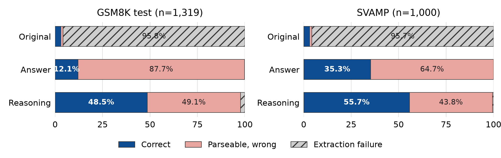

# Qwen QLoRA Math Reasoning

I compare answer-only and worked-solution supervision for
`Qwen/Qwen2.5-1.5B-Instruct` on GSM8K, then evaluate both adapters on GSM8K and
SVAMP. A shared numerical parser makes it possible to separate answer-format
learning from improvements in mathematical correctness.

[中文说明](README.zh-CN.md) · [Results notebook](notebooks/results_review.ipynb) ·
[Training notebook](math_reasoning.ipynb) · [Full report](report/report.pdf)

## Main results

All three conditions use the same chat prompt, greedy decoding, and 256-token
generation limit. An extraction failure counts as an incorrect answer.

| Condition | GSM8K accuracy | SVAMP accuracy | GSM8K extraction | SVAMP extraction |
| --- | ---: | ---: | ---: | ---: |
| Original | 3.03% | 3.10% | 4.25% | 4.30% |
| SFT-Answer | 12.05% | 35.30% | 99.77% | 100.00% |
| SFT-Reasoning | 48.52% | 55.70% | 97.65% | 99.50% |

Answer-only training learns the requested final-line format very reliably.
Worked-solution training produces substantially more correct numerical
answers, including among questions where both adapters yield a parseable
answer. The low original-model score is dominated by format failures under
this strict protocol; it is not a broad measure of Qwen's mathematical ability.



From Answer to Reasoning, GSM8K has 534 wrong-to-correct changes and 53
correct-to-wrong changes; SVAMP has 276 and 72. These paired counts compare
the same ordered questions.

## Additional experiments

| Reasoning condition | GSM8K accuracy | SVAMP accuracy |
| --- | ---: | ---: |
| Required rank 8 / alpha 16 | 48.52% | 55.70% |
| Rank 16 / alpha 32 | 47.69% | 53.20% |
| Calculator-annotation removal | 48.60% | 52.20% |
| 2,000 repeated GSM8K training examples | 43.75% | 52.10% |
| 2,000 filtered MathQA examples | 47.92% | 55.90% |

The MathQA mixture improves over the equal-size repetition control by 4.17
GSM8K and 3.80 SVAMP percentage points. Relative to the required reasoning
adapter, the mixture is slightly lower on GSM8K and slightly higher on SVAMP.
Increasing adapter capacity and removing calculator annotations do not improve
both tests in this run.

The project also compares 256 versus 512 generated tokens on a fixed
200-question validation slice and examines correct answers, arithmetic errors,
extraction failures, and cross-dataset regressions. All 18 additional evaluation
rows are included in the [optional scores](results/recorded/extensions_v2/optional_scores.csv).

## Method

The supplied course scaffold was completed with a custom forward-hook LoRA
implementation. NF4 and double quantization freeze the 1.5B base; low-rank
branches train the attention projections, MLP projections, and LM head.
The main adapters each contain 10,460,160 trainable parameters.

| Setting | Value |
| --- | --- |
| GSM8K train / validation | 6,725 / 748, seed 42 |
| Final evaluation | GSM8K test: 1,319; complete SVAMP: 1,000 |
| Training | 2 epochs, sequence limit 512, batch size 2 |
| Optimizer | AdamW, learning rate 1e-5, weight decay 0.01 |
| LoRA | Rank 8, alpha 16, dropout 0.1 |
| Evaluation | Greedy decoding, batch size 8, at most 256 new tokens |
| Recorded hardware | One RTX 5090, CUDA 12.8, PyTorch 2.8.0+cu128 |

The answer parser requires a single final line `#### <number>` and accepts
signs, commas, decimals, and simple fractions. It compares exact rational
values. Training targets supervise either this line alone or the worked
solution followed by the line; prompt tokens are masked from loss.

MathQA contributes 2,000 selected examples from 29,837 training records. Numeric
option checks, arithmetic-program checks, internal deduplication, and lexical
overlap checks leave 3,440 eligible records before sampling. The protected
question pool includes all supplied GSM8K and SVAMP questions. Details and
filtering counts are in the [data audit](results/recorded/extensions_v2/data_audit.json).

## Run the project

The recorded environment used Python 3.10. The complete training and optional
pipeline targets Linux or WSL2 with an NVIDIA GPU. The setup script creates a
project-local environment and installs
the recorded CUDA PyTorch version and pinned training dependencies.

```bash
bash setup.sh
.venv/bin/python run_experiments.py --smoke
.venv/bin/python run_experiments.py --full
```

The smoke run trains on eight training examples and generates on four
validation examples. The full command executes the baseline, both adapters,
the six evaluations, and the result checks. New files are written to `data/`,
`logs/`, `submission/`, `ckpt/`, and `analysis/`.

After the main run, fetch the checksum-pinned MathQA source and run the
additional comparisons:

```bash
.venv/bin/python scripts/fetch_mathqa.py
.venv/bin/python optional/extensions_v2/run_all.py --project "$PWD" --prepare
.venv/bin/python optional/extensions_v2/run_all.py --project "$PWD" --overnight
```

The optional runner uses the required adapters from the new run, executes the
capacity and token-budget study, then trains the three data variants. Existing
checkpoints support resumption. GPU-idle checks and process locks coordinate
the work on a shared server.

The exported results can be verified on a CPU with standard-library Python:

```bash
python scripts/verify_recorded_results.py
```

## Files and provenance

| Path | Contents |
| --- | --- |
| `math_reasoning.ipynb` | Portable training and evaluation pipeline |
| `run_experiments.py` | Notebook smoke/full runner with incremental saves |
| `optional/` | Capacity, decoding, cleaning, external-data, and readiness scripts |
| `results/recorded/` | Required and optional scores, compact prediction exports, logs, and audits |
| `notebooks/results_review.ipynb` | Saved results review without a model download |
| `figures/` | Outcome plot in PNG/PDF formats |
| `report/` | Project report and LaTeX source |

Historical exports preserve generated output, example IDs, numerical gold
answers, extraction flags, and correctness. Repeated chat prompts and worked
gold solutions are omitted from the bulk exports. The scoring outcomes are
unchanged, and the verification script recomputes them from the saved text.

The training notebook has portable paths and fixed model/dataset revisions.
Its execution outputs are generated by a new run. Historical code and export
hashes are recorded in [export provenance](results/recorded/export_provenance.json).

## Interpretation

The runs use one training seed. The 200-question validation slice is
exploratory, and every prespecified variant is reported on both full tests.
The MathQA and repetition conditions match sample counts and epochs, while
their token lengths differ. Lexical overlap checks cannot rule out every
semantic paraphrase or an incorrect source program that happens to match its
numeric option.

## Sources

- [Qwen2.5-1.5B-Instruct](https://huggingface.co/Qwen/Qwen2.5-1.5B-Instruct)
- [GSM8K](https://huggingface.co/datasets/openai/gsm8k)
- [SVAMP](https://github.com/arkilpatel/SVAMP)
- [MathQA](https://math-qa.github.io/math-QA/)
- [LoRA](https://arxiv.org/abs/2106.09685) and [QLoRA](https://arxiv.org/abs/2305.14314)

This is a portfolio edition of graduate NLP coursework. Models and raw
datasets are obtained from their upstream providers under their original
terms; assignment handouts and private server configuration are not included.
